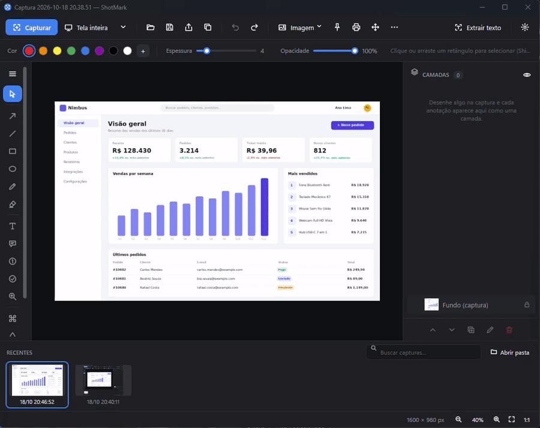
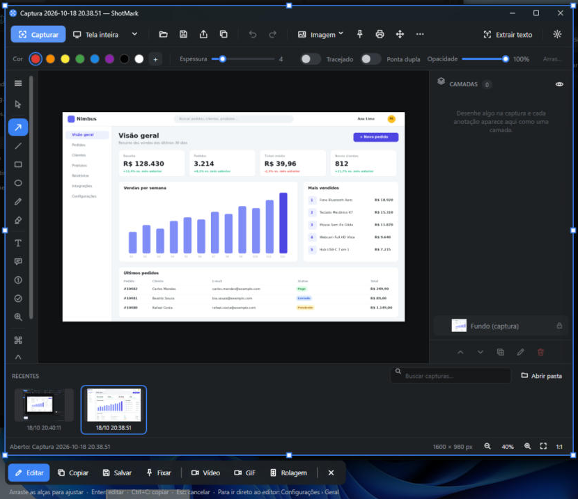
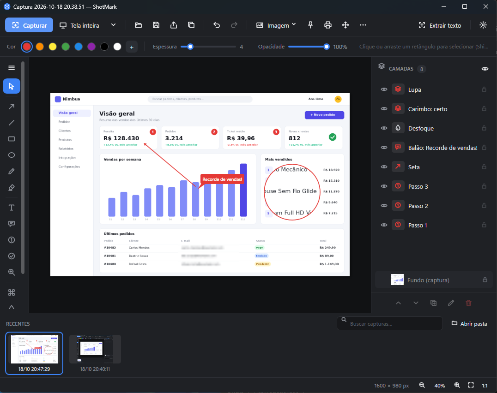
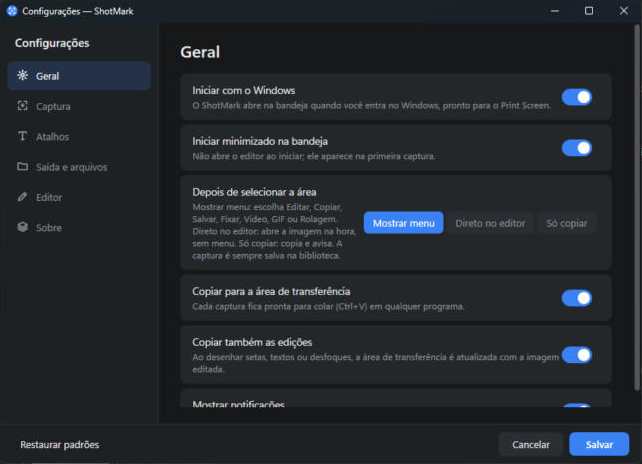

# ShotMark

[](https://dotnet.microsoft.com/)  [](https://github.com/geantrevisan/shotmark/releases/latest)


ShotMark é uma ferramenta de captura e anotação de tela para Windows, escrita em C# / .NET 8 (WPF). O código foi escrito do zero, sem usar código ou recursos de nenhum produto comercial.

<p align="center">
  
</p>

<p align="center"><a href="docs/demo.mp4">▶ Ver o vídeo em MP4</a></p>

## Capturas de tela

| Seleção com barra de ações | Editor com camadas |
|---|---|
|  |  |

<p align="center">
  
</p>

## Download

Baixe a versão mais recente em **[Releases](https://github.com/geantrevisan/shotmark/releases/latest)**:

| Arquivo | Para quem |
|---|---|
| `ShotMark-Setup-<versão>.exe` | Instalador (recomendado): atalho no Menu Iniciar, opção de iniciar com o Windows e desinstalador. Não precisa de administrador. |
| `ShotMark-<versão>-win-x64-portable.zip` | Versão portátil: descompacte e execute `ShotMark.exe`. |

Não é preciso instalar o .NET: o executável já inclui tudo. Requer Windows 10 (1809+) ou Windows 11, 64 bits.

> Na primeira execução o Windows SmartScreen pode avisar "editor desconhecido", porque o executável não tem assinatura digital. Clique em **Mais informações → Executar assim mesmo**.

## Requisitos

- Windows 10 (1809+) ou Windows 11
- [.NET 8 SDK](https://dotnet.microsoft.com/download/dotnet/8.0) (ou Visual Studio 2022 17.8+ com a carga ".NET desktop development")

## Compilar e executar

```powershell
cd ShotMark
dotnet build -c Release
dotnet run --project src/ShotMark
```

Para gerar um executável único:

```powershell
dotnet publish src/ShotMark -c Release -r win-x64 --self-contained false -p:PublishSingleFile=true -o publish
```

## Configurações (engrenagem no editor, Ctrl+, ou menu da bandeja)

- **Geral**: iniciar com o Windows, iniciar na bandeja, abrir o editor ou só copiar e avisar após capturar, notificações.
- **Captura**: tecla Print Screen, atraso padrão, incluir cursor, lupa, detecção inteligente.
- **Atalhos**: região, janela ativa, tela inteira, repetir última região, captura com atraso — todos configuráveis.
- **Saída**: pasta da biblioteca, padrão de nome ({data} {hora} {ano} {mes} {dia}), salvar imagem automaticamente, formato PNG/JPG/BMP, qualidade JPG.
- **Editor**: cor, espessura e fonte iniciais.

## Recursos avançados

- Captura com atraso (3/5/10 s, com contagem regressiva) e **repetir última região** (Ctrl+Shift+R).
- **Conta-gotas**: na seleção, a lupa mostra o #HEX do pixel; tecla **C** copia a cor.
- **Fixar na tela** (Ctrl+T): a imagem flutua por cima de tudo; arraste, roda = zoom, duplo clique/Esc fecha.
- **Alças de redimensionar** em setas, linhas, retângulos, elipses, pixelização, desfoque e holofote.
- Ferramentas **Desfoque** (U) e **Holofote** (G); **preenchimento** de retângulo/elipse e **opacidade** por camada.
- Menu **Imagem**: girar, espelhar, redimensionar, borda e sombra (as anotações acompanham).
- **Imprimir** (Ctrl+P).

## Novidades

- **Painel de Camadas** (à direita, como no Photoshop): cada anotação vira uma camada que pode ser mostrada/ocultada (olho), travada (cadeado), renomeada (F2 ou duplo clique), duplicada (Ctrl+D), reordenada (Ctrl+] / Ctrl+[) e excluída (Delete). Camadas ocultas não aparecem na exportação.
- **Print Screen em qualquer programa**: o ShotMark assume a tecla mesmo que a Ferramenta de Captura do Windows ou outro app tenha registrado. Pode ser desligado no menu da bandeja ("Usar a tecla Print Screen").
  - Print Screen: região/elemento · Alt+Print Screen: janela ativa · Shift+Print Screen: tela inteira
- **Captura inteligente**: ao passar o mouse, o ShotMark detecta botões, painéis, campos e listas (UI Automation). A **roda do mouse** (ou ↑/↓) alterna entre elemento menor → maior → janela → monitor.
- Interface redesenhada: ícones vetoriais, tema escuro consistente, barras de rolagem e controles próprios.

## Versão 2 — edição, captura e organização

**Captura**
- **Barra de ações** depois de selecionar: alças para ajustar a área e botões Editar · Copiar · Salvar · Fixar · Vídeo · GIF · Rolagem. Enter = editar, Ctrl+C = copiar, Ctrl+S = salvar, Esc = cancelar. Pode ser desligada em Configurações → Captura.
- **Gravação de tela em MP4** (H.264 do próprio Windows) **ou GIF animado**: contagem de 3 s, moldura vermelha na área, barra com tempo, Pausar, Parar e Cancelar. A moldura e a barra não aparecem no vídeo. Print Screen durante a gravação também para. Arquivos em `Biblioteca\Gravações`.
- **Captura com rolagem**: selecione a área que rola; o ShotMark rola com a roda do mouse e junta tudo numa imagem longa.

**Edição**
- Texto editado direto na imagem (duplo clique), com fonte, negrito e itálico.
- **Balão com ponteiro** (arraste a ponta), **lupa** (M), **carimbos** (S: ✓ ✗ ⚠ ℹ ? ★).
- Setas **curvas** (alça do meio), **duas pontas** e **tracejadas**.
- **Seleção múltipla** com retângulo, Shift/Ctrl+clique e Ctrl+A; copiar/colar camadas (Ctrl+C / Ctrl+V); reiniciar numeração dos passos.

**Organização**
- Busca na biblioteca por nome, data **e texto dentro das imagens** (OCR automático).
- Seleção múltipla e exclusão em lote na biblioteca.
- Exportar **PDF**, **copiar como arquivo** e **arrastar a imagem** (botão de alça) para outros apps.

**Confiabilidade**
- Log de erros em `%LocalAppData%\ShotMark\logs\shotmark.log`.
- Correção da seleção em monitores com escalas diferentes.

## Como usar

O ShotMark fica na bandeja do sistema (ícone azul).

| Ação | Atalho |
|---|---|
| Capturar região / elemento / janela | **Print Screen**, **Ctrl+Shift+X** ou **Ctrl+Alt+S** (ou clique no ícone da bandeja) |
| Capturar janela ativa | **Alt+Print Screen** |
| Capturar todas as telas | **Shift+Print Screen** ou **Ctrl+Shift+F** |

**Na sobreposição de captura**
- Arraste para selecionar uma região.
- Clique sem arrastar para capturar a janela ou o monitor sob o cursor.
- **Enter** captura o monitor inteiro, **Ctrl+A** captura todas as telas e **Esc** (ou o botão direito) cancela.
- Uma lupa mostra os pixels e as coordenadas sob o cursor.

> No Windows 11 a tecla Print Screen costuma estar reservada para a Ferramenta de Captura. Para liberá-la, desative *Configurações → Acessibilidade → Teclado → "Usar a tecla Print Screen para abrir a captura de tela"*, ou use **Ctrl+Shift+X**.

**No editor**

| Ferramenta | Tecla |
|---|---|
| Selecionar / mover | V |
| Seta (Shift = 45°) | A |
| Linha | L |
| Retângulo (Shift = quadrado) | R |
| Elipse (Shift = círculo) | E |
| Caneta | P |
| Marca-texto | H |
| Texto | T |
| Balão de texto | C |
| Passos numerados | N |
| Pixelizar (ocultar dados) | B |
| Recortar | X |

Outros atalhos:
- **Ctrl+Z / Ctrl+Y**: desfazer / refazer
- **Ctrl+C**: copiar a imagem com as anotações
- **Ctrl+V**: colar uma imagem como nova captura
- **Ctrl+S**: salvar
- **Ctrl+E**: exportar
- **Ctrl+O**: abrir
- **Delete**: excluir a anotação selecionada
- **Setas**: mover a seleção (Shift = 10 px)
- **Ctrl+roda do mouse**: zoom; **Ctrl+0** ajusta à janela e **Ctrl+1** volta a 100%
- Duplo clique em um texto (com a ferramenta Selecionar) para editá-lo
- Arraste imagens ou arquivos `.smk` para a janela para abri-los

O botão **Extrair texto (OCR)** usa o OCR que já vem no Windows (`Windows.Media.Ocr`). O texto reconhecido é copiado para a área de transferência.

## Onde ficam as capturas

Toda captura é salva automaticamente em `Imagens\ShotMark` como projeto `.smk`, e as anotações continuam editáveis. O `.smk` é um ZIP com:

- `image.png`: a imagem original
- `document.json`: as anotações (formato JSON versionado)
- `preview.png`: uma miniatura com as anotações aplicadas

Para gerar um PNG/JPG final, use **Exportar** ou **Copiar**.

> Se outro programa de captura (Snagit, Ferramenta de Captura, ShareX…) estiver aberto, ele pode já ter registrado esses atalhos. Nesse caso o ShotMark avisa pela bandeja quais teclas não conseguiu registrar.

## Gerar o instalador

- **Local:** `build-installer.cmd 1.0.0` gera em `dist\` o ZIP portátil e, se o [Inno Setup 6](https://jrsoftware.org/isinfo.php) estiver instalado (`winget install JRSoftware.InnoSetup`), o `ShotMark-Setup-1.0.0.exe`.
- **GitHub (automático):** ao enviar uma tag de versão, o GitHub Actions compila, gera o instalador, o ZIP e os checksums, e publica a release:

```
git tag v1.0.0
git push origin v1.0.0
```

O script do instalador fica em `installer/ShotMark.iss` e os workflows em `.github/workflows/`.

## Compilar com um clique

`build.cmd` fecha o ShotMark que estiver aberto, compila em Release, grava a saída em `build.log` e abre o app se a compilação passar.

## Diagnóstico

Para registrar quais janelas a captura detecta, crie um arquivo vazio `debug.flag` ao lado do `ShotMark.exe`. A cada captura ele grava `regions-debug.txt` na mesma pasta. Apague o `debug.flag` para desligar.

## Estrutura do código

```
src/ShotMark/
  App.xaml(.cs)            Bandeja, atalhos globais, fluxo de captura
  Native/NativeMethods.cs  Interop Win32 (RegisterHotKey, EnumWindows, DWM…)
  Capture/
    ScreenCapturer.cs      Captura da tela virtual + regiões de janelas/monitores
    CaptureOverlay.cs      Sobreposição de seleção com lupa
    HotkeyManager.cs       Atalhos globais (janela message-only)
  Core/
    Annotations.cs         Modelos de anotação (render + hit-test + JSON polimórfico)
    CaptureDocument.cs     Documento e formato .smk
    ImageUtil.cs           Normalização, recorte, achatamento, exportação
    EditHistory.cs         Desfazer/refazer por snapshots
    Library.cs             Biblioteca em Imagens\ShotMark
  Editor/
    EditorWindow.xaml(.cs) Janela do editor
    EditorCanvas.cs        Superfície de desenho e gestos do mouse
    TextInputDialog.cs     Diálogo de texto
  Services/OcrService.cs   OCR nativo do Windows
```

## Próximos passos sugeridos

- Áudio (microfone/sistema) nas gravações
- Editor de vídeo (cortar início/fim)
- Compartilhamento (e-mail, nuvem, link)
- Versões para Linux e macOS (migração da interface para Avalonia)

## Autor

**Gean Fioramonte Trevisan**

- LinkedIn: [br.linkedin.com/in/geanfioramonte](https://br.linkedin.com/in/geanfioramonte)
- GitHub: [github.com/geantrevisan](https://github.com/geantrevisan)
